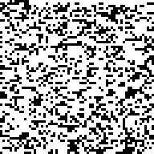
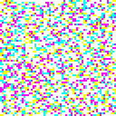
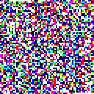

# MakoCode🐾

A standard for color barcode printing with high density, designed for long-term archiving on paper or film. Self-contained clean-room implementation with no dependencies, single file.

Stubborn and dense as a Shiba, with no fluff. Lovingly named after my Shiba Inu, Mako 🐕, and about as silly as him.

Written entirely with codex-gpt-5.

## License

Copyright © 2026 Justin Alan Bass. MakoCode is licensed under the GNU Affero
General Public License, version 3 or later. See [LICENSE](LICENSE) for the
complete license text.

## Dependencies

Totally standalone for future-proofing, c++ and g++ required for compiling. CLI tests require bash.

## Usage

```
make
make test
./makocode encode --input=file.txt
./makocode encode --input=file.txt --palette "White Black"
# Print, store, scan the output shown above
./makocode decode scan.ppm
# To write one decoded file instead:
./makocode decode --decoded-file scan.ppm
./makocode decode --decoded-stdout scan.ppm
```

Decode restores the original file tree by default. `--decoded-file` writes a timestamped `makocode_decoded_YYYYMMDDHHMMSS.txt` containing page and payload metadata and escaped archive entries. `--decoded-stdout` prints the same content without creating files; it cannot be combined with `--decoded-file` or `--debug`. Archive paths cannot be absolute or contain `..`. Extraction may follow symlinks in the output directory; use a fresh, trusted directory for untrusted input.

The decoded file uses ASCII lines, begins with `MAKOCODE-DECODED`, and ends with `end`. Each `page N` section contains `metadata NAME VALUE` lines and ends with `end-page`. The `payload` section uses the same metadata form and ends with `end-payload`. Byte arrays in metadata are uppercase hexadecimal; numeric fields are decimal. Fields are present only when recovered. Page sections report the recovered metadata fields without the raw tile header or tile bytes.

The `archive` section gives `entries COUNT`, followed by `directory PATH` and `file PATH SIZE` entries in archive order, and ends with `end-archive`. A file's next line is its complete content; `SIZE` is its original byte count. Backslash, nonprintable bytes, and spaces in paths are encoded as `\xHH` with two uppercase hexadecimal digits. Content spaces are literal. All lines end in LF; even an empty file has a content line. Escaping applies to bytes, so UTF-8 and binary contents can be reconstructed exactly. Footer text is rendered in the image and is not recovered into the decoded file.

### Error correction and overlays

`encode --ecc RATIO` sets the requested Reed–Solomon parity/data ratio on the compressed, then optionally encrypted, payload. The CLI accepts `0.00` through `655.35` in hundredths; the default is `0.10`. `0.00` disables payload ECC, but the metadata tile overwrites payload positions, so the encoder rejects a target that cannot recover those known erasures. Positive targets round up to integer parity-symbol counts per block. Configured overlays add their own erasure budget. The encoder reports a sufficient base `--ecc` value when the requested target is insufficient for the current payload and page layout. This covers known structural and configured overlay erasures; image damage can still require more ECC. GF(256) blocks contain at most 255 total symbols, so the realized ratio cannot exceed 254 parity symbols for one data symbol. `--ecc-fill` searches for the largest feasible target that fills the final page.

`encode --overlay-fraction F` sets the maximum overlay amount used to derive per-block erasure selectors. CLI values use two decimal places from `0.00` through `0.99`; `1.00` is invalid. Schema 8 and later store this value as Q0.16: the compact `u16` value divided by 65536. For example, `0.20` is stored as 13107, and the largest representable wire value, 65535, means `65535/65536` (about `0.9999847`), never `1.00`. The decoder derives each block's selector count as the ceiling of this fraction times the block's data-plus-parity symbols. Encoding rejects a target when that count exceeds the available parity. The positional fraction on `makocode overlay` is the requested raster change amount; the encoded selector count bounds how many codeword positions can be changed.

## Tests

`make test` now drives the CLI end-to-end through the shell scripts in `test/`
(round-trip, payload suite, overlay, CLI output-dir, and decode failure cases).
Test artifacts are written to `test_output/` using the labels defined in each
case registration (e.g., `0002_baseline_8k_ecc_050_*`,
`0015_gray_100k_single_*`).
Encoded PPM pages remain directly in `test_output/`. Standard round-trip tests
pipe payloads into `encode` and compare `decode --decoded-stdout`; dedicated
file and directory tests keep their filesystem fixtures and outputs. Each test
run clears prior output before writing fresh artifacts. No visual-link directory
is created.

Test cases are registered in `test/test_cases.sh`. Run independent cases in
parallel with GNU Make using `make -j test`. Each completed case prints one
result line; its full output is saved in `test_output/test_logs/`. Use `make test TEST_VERBOSE=1`
to stream full output instead.

Each `make test` run prints its master seed and writes it to `test_output/test_seed.txt`.
Repeat a randomized run with the same seed using:

```
MAKO_TEST_SEED=$(cat test_output/test_seed.txt) make -j test
```

You can also choose a seed explicitly, for example `MAKO_TEST_SEED=12345 make -j test`.
Random payload seeds are derived from the master seed and test label, so each case
gets a stable payload when replayed.

### Coverage

To run the same end-to-end suite with GCC/gcov instrumentation and produce an
HTML coverage report, install `lcov` (which also ships `genhtml`) and run:

```
make coverage
```

This rebuilds `makocode` with `--coverage -O0 -g`, executes every case in
`test/run_test_suite.sh`, and writes `test_output/makocode.info` plus an HTML
dashboard under `test_output/coverage/index.html`.

### Calibration

```
python3 scripts/calibration.py encode --width 2398 --height 2957
```

```
python3 scripts/calibration.py decode scan.ppm
```

The generated sheet has a 4x4 grid of equal-size barcodes. The four columns use
White/Black; White/Cyan/Magenta/Yellow; that palette plus Black; and the
eight-color White/Red/Green/Blue/Yellow/Magenta/Cyan/Black palette. Rows use
1x, 2x, 3x, and 4x pixels per dot, from top to bottom. Every barcode encodes
`makocode` followed by deterministic padding sized to fill its available page
capacity. The minimum page size is 1186x1200; larger pages enlarge every
barcode equally. Higher-capacity palettes receive more padding bytes, so the
8-color mode fills the same visual area as the 1-bit mode.

Decode checks all 16 barcodes and reports the smallest pixels-per-dot setting
that decodes for each mode. Its maximum bytes-per-page estimate extrapolates
the densest successful mode and scale across the full page as flat data,
adjusted for scan scale, and ignores metadata, fiducials, and other overhead.
The PPM footer prints `width: N, height: N` in the default 5x8 footer font.

Handy linux printing command:

```
lpstat -p
lp -d HL-L3220CDW -o ppi=600 -o natural-scaling=100 -o sides=one-sided calibration.ppm
```

### Converting Scans

To turn a scanned image into a P6 `.ppm` file for decoding, install ImageMagick (`brew install imagemagick` on macOS, `sudo apt install imagemagick` on Debian/Ubuntu) and run `convert scan.png -depth 8 -compress none scan.ppm`.

### Custom Palettes (Base-N Mode)

- Pass `--palette "Color ..."` to `encode`/`decode` with 2–16 unique entries selected from the existing names (`White`, `Cyan`, `Magenta`, `Yellow`, `Black`). Examples: `--palette "White Black"` (binary), `--palette "White Cyan Magenta"` (base‑3), `--palette "White Cyan Magenta Yellow Black"` (base‑5). Quote the list so the CLI keeps the whitespace intact.
- The encoder automatically maps each page’s bitstream into base‑N digits (where `N` equals the palette length), pads out every non-reserved pixel, and chooses footer foreground/background colors by measuring palette contrast—no need for fixed White/Black endpoints.
- Palette metadata is embedded per page (via `MAKOCODE_PALETTE`, `MAKOCODE_PALETTE_BASE`, and `MAKOCODE_PAGE_SYMBOLS`), so `decode` normally discovers the palette automatically, but you can still force it with `--palette ...` if desired.

## Sample Barcodes

Examples of the encoded output for 2, 4, and 8 colors:




