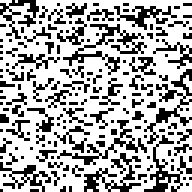
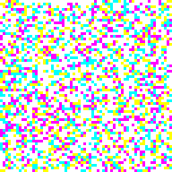
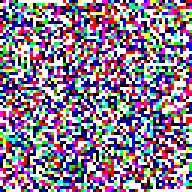

# MakoCode🐾

A standard for color barcode printing with high density, designed for long-term archiving on paper or film. Self-contained clean-room implementation with no dependencies, single file.

Stubborn and dense as a Shiba, with no fluff. Lovingly named after my Shiba Inu, Mako 🐕, and about as silly as him.

Written entirely with gpt (totally not vibecoded).

## License

Copyright © 2026 Justin Alan Bass. MakoCode is licensed under the GNU Affero
General Public License, version 3 or later. See [LICENSE](LICENSE) for the
complete license text.

## Dependencies

The application is a standalone C++17 program. Building and running the CLI tests requires a C++17 compiler and GNU Make. The test runner uses POSIX process APIs to invoke the CLI.

## Usage

```
make
make test
./makocode encode --input=file.txt
./makocode encode --input=file.txt --palette "White Black"
# Render the minified source at an explicit page size
./makocode minify --width 2398 --height 2957
# Print, store, scan the output shown above
./makocode decode scan.ppm
# To write one decoded file instead:
./makocode decode --decoded-file scan.ppm
./makocode decode --decoded-stdout scan.ppm
```

### Incremental checkpoints

`checkpoint create` builds a single checkpoint bundle from the supplied file or directory inputs. Repeat `--base` for previously decoded trees whose chunks may be reused. The bundle contains a full snapshot manifest and only chunk bodies not found in the base data. `--chunk-size` sets the average content-defined chunk target (default `4M`; accepted range `256` bytes through `1G`). Chunk sizes are approximate page targets; normal `encode` compression and layout determine the actual page use.

```sh
./makocode checkpoint create --input current --base previous --output current.mcp --chunk-size 4M
./makocode encode --input current.mcp --output-dir pages --password 'secret' --random-data="$random"
./makocode decode --output-dir decoded --password 'secret' pages/*.ppm
./makocode checkpoint restore --input decoded/current.mcp --base previous --output restored
```

Checkpoint bundles are files, so the existing `encode`/`decode` options remain in control of page layout, encryption, ECC, hidden capacity, and filler. A bundle and its decoded bases are plaintext local files; encrypted page output protects the manifest and chunk references. Page count and dimensions remain observable. Checkpoint IDs use SHA-256 and the manifest is inside the encoded payload.

Restore uses every matching chunk it can find in the bundle and supplied bases. If some chunks are unavailable or damaged, it still writes the available data: incomplete files receive a `.partial` suffix, missing byte ranges are zero-filled, and `checkpoint_recovery.txt` lists missing ranges and chunk IDs. For example, checkpoint 2 can be restored with checkpoint 0 even if checkpoint 1 is missing; references available only in checkpoint 1 become missing ranges in the partial output. Empty files and directories are preserved. As with ordinary archive inputs, checkpoint creation supports regular files and directories.

### Archival Notes

Prefer simple, well-documented formats: UTF-8 `.txt` for text, binary P6 `.ppm` for still images, and YUV4MPEG2 `.y4m` for video. PPM and YUV4MPEG2 store uncompressed samples; MakoCode compresses the archive payload with LZMA. Keep a short note with encoding, dimensions, frame rate, and color/chroma settings, and retain checksums separately. Assume archivists can interpret the C++ source and build notes without preserving the compiler's source. Avoid nonstandard file formats unless their complete decoder/codec source or format specification is archived with the data. These choices favor straightforward decoding, though uncompressed media can require substantial space. See the [PPM specification](https://netpbm.sourceforge.net/doc/ppm.html) and [YUV4MPEG2 format notes](https://manpages.debian.org/unstable/mjpegtools/yuv4mpeg.5.en.html).

Decode restores the original file tree by default. `--decoded-file` writes a timestamped `makocode_decoded_YYYYMMDDHHMMSS.txt` containing page and payload metadata and escaped archive entries. `--decoded-stdout` prints the same content without creating files; it cannot be combined with `--decoded-file` or `--debug`. Archive paths cannot be absolute or contain `..`. Extraction may follow symlinks in the output directory; use a fresh, trusted directory for untrusted input.

### Encryption randomness

Encrypted encoding requires `--random-data HEX`: exactly 56 hexadecimal digits (28 bytes), split into a 16-byte salt and 12-byte nonce. Generate fresh data for every encoding. MakoCode accepts the bytes from you and does not obtain randomness from the operating system. This keeps the single-file source portable and avoids platform-specific random APIs and build dependencies.

Linux and macOS:

```sh
random=$(od -An -N28 -tx1 /dev/urandom | tr -d ' \n')
./makocode encode --input=file.txt --password=... --random-data="$random"
```

Windows PowerShell:

```powershell
$bytes = [byte[]]::new(28)
[Security.Cryptography.RandomNumberGenerator]::Fill($bytes)
$random = [Convert]::ToHexString($bytes)
.\makocode.exe encode --input=file.txt --password=... --random-data=$random
```

Diceware can supply the randomness too; these words are entropy input, not the encryption password. Use 18 independently selected words (about 232 bits of entropy), hash their exact space-separated text, and take 56 hex digits (28 bytes). Linux:

```sh
words='word1 word2 word3 word4 word5 word6 word7 word8 word9 word10 word11 word12 word13 word14 word15 word16 word17 word18'
random=$(printf '%s' "$words" | sha256sum | cut -c1-56)
./makocode encode --input=file.txt --password=... --random-data="$random"
```

On macOS replace `sha256sum` with `shasum -a 256`. In PowerShell, set `$words` to the 18 words, then run:

```powershell
$sha = [Security.Cryptography.SHA256]::Create()
$digest = $sha.ComputeHash([Text.Encoding]::UTF8.GetBytes($words))
$random = [Convert]::ToHexString($digest).Substring(0, 56)
.\makocode.exe encode --input=file.txt --password=... --random-data=$random
```

Use a newly generated value for every encryption. Hashing formats the Diceware entropy into the required bytes; it does not add entropy.

### Hidden-capacity volumes and random page fill

`--hidden 0` is the default ordinary format and leaves the existing payload layout unchanged. `--hidden R` reserves hidden capacity equal to `R` times the visible encrypted body length: `0.5` reserves about one third of the combined data region, and `2` reserves about two thirds. The hidden capacity is a limit; unused bytes at its end contain pseudorandom filler. Hidden mode requires the visible `--password` and `--random-data`, so its visible-body length descriptor is encrypted.

To store a hidden archive, provide both `--hidden-input PATH` and `--hidden-password TEXT`, in addition to the visible `--password` and `--random-data`. The two passwords must differ. Decode the visible or hidden archive by supplying its corresponding password. If no hidden input is supplied, the hidden-capacity region contains random filler only. `--hidden fill` uses the remaining data capacity of one page; `--fill-pages N` extends page fill to `N` physical pages when used with `--hidden fill` or `--ecc fill`. Combining `--hidden fill` with `--ecc fill` is rejected because both would claim the same capacity.

Hidden descriptors and archive bodies are authenticated and encrypted in the data section. The container begins with only the supplied salt and nonce; no clear format marker identifies hidden mode. Decoding recognizes a container only when a supplied password authenticates one of its descriptors. Page count and page dimensions remain observable. ECC covers the encoded data section; random physical page fill after the protected stream is outside the RS codewords and is ignored during extraction. Page filling requires fresh `--random-data`, which can be supplied without `--password` when it is used only to seed filler.

The decoded file uses ASCII lines, begins with `MAKOCODE-DECODED`, and ends with `end`. Each `page N` section contains `metadata NAME VALUE` lines and ends with `end-page`. The `payload` section uses the same metadata form and ends with `end-payload`. Byte arrays in metadata are uppercase hexadecimal; numeric fields are decimal. Fields are present only when recovered. Page sections report the recovered metadata fields without the raw tile header or tile bytes.

The `archive` section gives `entries COUNT`, followed by `directory PATH` and `file PATH SIZE` entries in archive order, and ends with `end-archive`. A file's next line is its complete content; `SIZE` is its original byte count. Backslash, nonprintable bytes, and spaces in paths are encoded as `\xHH` with two uppercase hexadecimal digits. Content spaces are literal. All lines end in LF; even an empty file has a content line. Escaping applies to bytes, so UTF-8 and binary contents can be reconstructed exactly. Footer text is rendered in the image and is not recovered into the decoded file.

### Error correction and overlays

`encode --ecc RATIO` sets the requested Reed–Solomon parity/data ratio on the compressed, then optionally encrypted, payload. Numeric ratios accept decimal values from `0` through `254`; `--ecc 0` disables payload ECC. If `--ecc` is omitted, the encoder selects the minimum ratio that covers metadata, fiducial, and configured overlay erasures. If the selected ratio cannot cover those erasures, encoding fails and reports a sufficient ratio and the overlay fraction the current ECC can support. Positive ratios map to integer parity symbols per block. GF(256) blocks contain at most 255 total symbols, so the physical maximum is 254 parity symbols for one data symbol. `--ecc fill` searches the feasible block layouts for the best final-page use.

`encode --metadata-pages LIST` writes the center metadata tile only on selected pages. `LIST` accepts `all` (the default), page numbers, ranges, `middle`, and `last`; for example, `--metadata-pages=middle` writes the tile on page 2 of a three-page encoding. Pages without a tile still carry payload in the same raster positions. Multi-page decode therefore needs at least one supplied page with readable metadata.

`encode --overlay-fraction F --overlay-ppm overlay.ppm --overlay-pages LIST` reserves an overlay erasure budget and applies the supplied PPM to the selected generated pages. Repeat the `--overlay-ppm`/`--overlay-pages` pair for multiple images; `LIST` accepts `all` (the default), page numbers, ranges, `middle`, or `last`, and pages may be assigned only once. At least one overlay image and `--overlay-fraction` must be supplied together, and each PPM's dimensions must match the encoded pages. `F` ranges from `0.0` through `254/255` and is a share of each Reed–Solomon codeword. For a block with `K` data and `P` parity symbols, the encoder reserves `O = ceil((K + P) × F)` erasures; the selector uses the same `O` positions in every block. The theoretical maximum is `254/255`: one data symbol and 254 parity symbols in a 255-symbol block. Structural erasures also consume parity, so some page layouts can support a slightly lower fraction. Schema 0 stores per-block parity `P` and overlay erasures `O` as compact `u16` values, plus payload size and block data size `K`. The decoder derives the block count from the payload size and `K`; `O` must not exceed `P`, and each block has at most 255 symbols. Overlay positions are selected deterministically per block. If the requested overlay budget exceeds available parity, encoding fails and reports a sufficient `--ecc` ratio and/or the maximum supported `--overlay-fraction`.

Decode marks the full reserved selector as erased, including symbols left unchanged because `--overlay-ignore-colors` skipped their overlay pixels. That option does not reduce the ECC erasure budget.

If erasure decoding fails, decode retries without erasure hints. The retry can use the same parity to correct overlay changes and other errors together as unknown errors, up to half the block's parity-symbol count. For example, 100 parity symbols can correct 40 overlay errors and 10 other errors.

Multi-page overlays with an explicit numeric ECC ratio require at least `--ecc 0.5`; larger overlay fractions may require more parity. Lower ratios are rejected before page output because they can exceed the correction budget across filled pages.

## Tests

`makocode_test.cpp` contains the test suite and runs the application through its
CLI. It builds as a separate executable and does not affect the source embedded
by `makocode minify`. Run all cases with:

```
make -j4 test
```

The runner uses the job count from `make -jN`; each case prints one result line.
Work files and captured CLI output are kept in separate directories under
`test_output/`. `make clean` removes them. List case IDs with
`./makocode_test --list` or run one case with `./makocode_test --case CASE_ID`.
In terminals, `[TEST]` is blue, `[PASS]` is green, and `[FAIL]` is red.

Each run prints a master seed and writes it to
`test_output/test_logs/test_seed.txt`. Repeat a randomized run with the same
seed using:

```
MAKO_TEST_SEED=$(cat test_output/test_logs/test_seed.txt) make -j4 test
```

You can also choose a seed explicitly, for example
`MAKO_TEST_SEED=12345 make -j4 test`. Random fixture seeds are derived from the
master seed and case label.

### Coverage

To run the same end-to-end suite with GCC/gcov instrumentation and produce an
HTML coverage report, install `lcov` (which also ships `genhtml`) and run:

```
make coverage
```

This rebuilds both executables with `--coverage -O0 -g`, runs the same C++ test
suite, and writes `test_output/coverage/makocode.info` plus an HTML dashboard
under `test_output/coverage/index.html`.

### Calibration

```
python3 scripts/calibration.py encode --width 2398 --height 2957
```

```
python3 scripts/calibration.py decode scan.ppm
```

The generated sheet has a 4x4 grid of equal-size barcodes. Its four columns use
these ordered palettes: `White Black`; `White Cyan Magenta Yellow`;
`White Cyan Magenta Yellow Black`; and
`White #FF0000 #00FF00 #0000FF Yellow Magenta Cyan Black`. Rows use 1x, 2x, 3x,
and 4x pixels per dot, from top to bottom. Every barcode encodes
`makocode` followed by deterministic padding sized to fill its available page
capacity. The minimum page size is 1186x1200; larger pages enlarge every
barcode equally. Higher-capacity palettes receive more padding bytes, so the
8-color mode fills the same visual area as the 1-bit mode.

Decode checks all 16 barcodes and reports the smallest pixels-per-dot setting
that decodes for each mode. Its maximum bytes-per-page estimate extrapolates
the densest successful mode and scale across the full page as flat data,
adjusted for scan scale, and ignores metadata, fiducials, and other overhead.
The PPM footer prints `width: N, height: N` in the default 5x8 footer font.

Handy linux printing command:

```
lpstat -p
lp -d HL-L3220CDW -o ppi=600 -o natural-scaling=100 -o sides=one-sided calibration.ppm
```

### Converting Scans

To turn a scanned image into a P6 `.ppm` file for decoding, install ImageMagick (`brew install imagemagick` on macOS, `sudo apt install imagemagick` on Debian/Ubuntu) and run `convert scan.png -depth 8 -compress none scan.ppm`.

### Custom Palettes (Base-N Mode)

- Pass `--palette "Color ..."` to `encode`/`decode` with 2–16 unique ordered entries using the built-in names (`White`, `Cyan`, `Magenta`, `Yellow`, `Black`) or `#RRGGBB` values. Examples: `--palette "White Black"` (2 colors), `--palette "White Cyan Magenta"` (base‑3), `--palette "White Cyan Magenta Yellow Black"` (base‑5). Quote the list so the CLI keeps the whitespace intact.
- The encoder automatically maps each page’s bitstream into base‑N digits (where `N` equals the palette length), pads out every non-reserved pixel, and chooses footer foreground/background colors by measuring palette contrast—no need for fixed White/Black endpoints.
- Palette metadata is embedded per page (via `MAKOCODE_PALETTE`, `MAKOCODE_PALETTE_BASE`, and `MAKOCODE_PAGE_SYMBOLS`), so `decode` normally discovers the palette automatically, but you can still force it with `--palette ...` if desired.
- Use `decode --recover-palette` when the embedded palette row is damaged. Recovery first tries the common ordered palettes for 2, 4, 5, and 8 colors, using colors sampled from the whole page to account for scan shifts. It then tries image-derived palette clusters and their orderings before exhaustive RGB candidates. `--recover-limit N` limits ordered palette candidates (default `4`); increase it to continue beyond the common palettes. If you already know the palette, pass the encoder-style ordered list with `--palette` to try it first.

## Sample Barcodes

Examples of the encoded output for 2, 4, and 8 colors:




